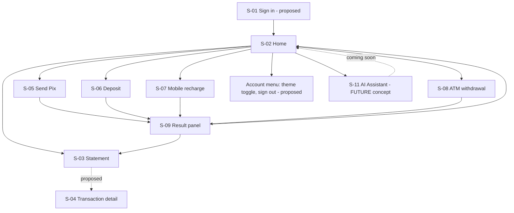

# Designer Agent Brief — UI/UX Prototyping & Template Creation

> **Update 2026-11-02:** the prototype was delivered in `../prototype/Maia Bank UI prototype/` and is now the visual reference. Where this brief's §3 tokens (Grafite Ciano) differ from the prototype, **the prototype wins**. This brief remains the requirements baseline for any new design iteration.

**Audience:** a design/prototyping agent (no access to the codebase). **Self-contained:** everything needed to design every screen, flow and navigation path supported by the real backend is below.
**Language:** English only (all UI copy in English). **Theme:** Grafite Ciano, dark default + light (D-17).
**Update 2026-11-03 (D-22):** the backend additions `GET /accounts/me` (agency, number, balance) and statement row `id` are **approved**; screens tagged for them (Home balance, S-04 Transaction detail, row→detail navigation) are design-ready and no longer optional. Login (S-01) stays tagged Proposed until the Okta integration is implemented. The `operator` role does not exist (customer only).
**Status legend (plus [FUTURE] = designed concept only, no backend, tagged "Coming soon"):** **[REAL]** backed by an existing endpoint · **[PROPOSAL]** needs backend work/decision, design it but mark it with a "Proposed" tag in the file · **[ABSENT]** does not exist: **do not design it**.

## 0. Platform and product positioning (read first — updated 2026-11-03, decisions D-27, D-28)
* **Web only, browser only.** The product is a responsive **web application used in a browser** (desktop, tablet and mobile *browsers*). There is **no native iOS/Android app, no app store, no PWA install flow, no push notifications, no biometrics/Face ID, no haptics, no camera/QR scanning, no NFC, no offline mode**. Every transaction (Pix, deposit, recharge, withdrawal) and every query happens **inside the browser UI**. Design for mouse, keyboard, touch-in-browser and browser conventions: URLs and deep links, back/forward buttons, tabs, refresh, hover, focus, text selection, copy/paste and browser zoom.
* **Portfolio prototype, functional, not a production bank.** It runs against real endpoints with **test data only** and must look and feel like a **modern online bank / neobank web app**: confident, spacious, fast-feeling, fintech-grade polish (match the quality bar of modern neobank dashboards, but **do not copy any real bank's brand, layout or assets**). It is a showcase of craft: strong visual hierarchy, delightful micro-interactions, purposeful motion, excellent empty/loading/error states. Design a few **memorable moments** (animated balance count-up on first load, smooth period transitions, an elegant animated success state, a polished landing/sign-in page) but never at the expense of clarity or accessibility.
* **Demo honesty.** Show a discreet, persistent "Demo environment · test data only" indicator (header chip + footer line). Never imply real money, a real bank or regulatory status. The wordmark "Maia Bank" is a placeholder.
* **Scope of the modern online-bank experience.** Beyond the transactional and query flows, the design includes a polished **public landing/sign-in page** and an **AI Assistant section that is a future plan** (§6 S-11, flow F-9): designed and clickable as a concept, **not functional**, clearly labelled "Coming soon".
* Production-only concerns (SLAs, compliance copy, multi-region, real KYC/onboarding) are **out of scope**.

## 1. Mission and deliverables
Design a web banking app ("account holder" persona) for a service that offers: sending Pix, mobile recharge, ATM withdrawal, deposit, and a statement with totals.
Deliver (in this order):
1. **Foundations sheet** — color tokens (both themes), type scale, spacing, radius, elevation, motion, iconography (one stroke icon family, no emoji).
2. **Component library** — each component with all states (default, hover, focus, active, disabled, loading, invalid, success) in both themes (§8).
3. **Screen templates** — every screen in §6 at 3 breakpoints (mobile 360, tablet 768, desktop 1280) × 2 themes, with all data states (loading skeleton, empty, success, error) shown as separate frames.
4. **Clickable prototype** — flows F-1…F-8 (§7) wired exactly as specified, including error branches.
5. **Handoff package** — design-token export (JSON), screen/state naming per §12, annotations for a11y order and responsive behavior, copy deck (§10).

## 2. Hard rules (do not violate)
* Design **only** what the endpoints support (§4), **plus** the two explicitly allowed non-endpoint pieces: the landing/sign-in page (S-01) and the **AI Assistant concept (S-11, Future)**. Do not invent: categories, budgets, goals, cards, invoices, scheduled/recurring payments, contacts/favorites, receipts PDF, notifications center, multi-account switcher, profile editing, transfers between own accounts, export/CSV, search by text, loans, investments, native-app patterns (§0).
* The backend returns **no body** on successful writes (HTTP 204) and no transaction id: success screens must show only data the user just typed plus a client-side timestamp labelled "recorded on this device".
* Money is Brazilian reais shown as `R$ 1,234.56` (en-US number format, `R$` prefix, always 2 decimals, tabular numerals).
* Dates shown as `Nov 2, 2026` / `Nov 2, 2026, 14:35`; backend date filter format `dd/MM/yyyy` is an implementation detail never shown to users.
* Never use color alone to signal income/outgoing/error: always icon + text/sign.
* The UI never states a balance it did not receive from the backend and never claims an operation "completed" beyond what the API confirms (recharge is only **requested**).
* The AI Assistant is a **Future** feature: it must be visibly tagged "Coming soon", must not call any endpoint, must never present fabricated financial facts as real (the sample conversation uses obviously sample data labelled "Example"), and must not look like it can move money.
* WCAG 2.2 AA; touch targets ≥ 44 px; one primary action per screen; reduced-motion variant for every animation.

## 3. Visual identity (Grafite Ciano)
Personality: calm, precise, trustworthy; the **money figures are the hero**; controls recede; one accent color.
| Token | Dark (default) | Light | Use |
|---|---|---|---|
| surface | #0A0F1A | #F4F6FA | app background |
| surface-raised | #121A2B | #FFFFFF | cards, header |
| surface-sunken | #0C1322 | #EEF1F6 | inputs, wells |
| surface-overlay | #172136 | #FFFFFF | menus, dialogs, toasts |
| brand (side nav) | #0D1424 | #0F172A | navigation rail |
| line / line-input | #1F2A40 / #5B6B8A | #D5DBE6 / #7B8AA3 | borders |
| content / content-muted | #E6EDF7 / #9AA8BF | #0F172A / #4B5A70 | text |
| accent / on-accent | #38BDF8 / #06121F | #0369A1 / #FFFFFF | primary action, focus ring, selection |
| income | #34D399 | #047857 | incoming (deposits) |
| expense | #FB7185 | #BE123C | outgoing, errors |
| warning | #FBBF24 | #92400E | caution (e.g., amount near balance) |
Radius: control 8 px, card 12 px. Elevation in dark = surface step + 1 px border, shadows only on overlays. Motion 150–250 ms ease-standard. Typography: Inter; base 16/24; display numerals 40–56 px for balance; `tabular-nums` everywhere for money/dates. Verify contrast (text ≥ 4.5:1, UI ≥ 3:1) in both themes and report any token that fails (propose a corrected value).
Distinctive motifs to avoid a generic template look: (a) large balance numeral with a muted `R$`; (b) **ledger rail** — each statement row has a 3 px left rail (income/outgoing) plus a type icon; (c) segmented "income vs outgoing" bar under the balance; (d) review-before-confirm pattern with a dashed "receipt" card on money-moving screens.

## 4. Endpoint → capability map (source of truth)
| Endpoint | What the user can do | Request fields | Success | Possible errors (exact backend messages) |
|---|---|---|---|---|
| `POST /api/v1/transactions/send-pix` | Send Pix | `pixKey` (text), `keyType` (`cpf`/`email`/`phone`), `transactionAmount` | 204 | 422: "Pix key is required" · "Transaction amount must be positive and non-null" · "Key type is required" · "Pix key does not exist or is invalid for the specified type: …" · "Operation not performed, there is not enough balance in the account." · "Fail send Pix." |
| `POST /api/v1/transactions/deposit` | Deposit cash to an account | `agency` (text), `account` (text), `amount` | 204 | 404 "Account not found." · 422 "Amount must be positive and non-null" · "Fail deposito at account …" |
| `POST /api/v1/transactions/recharge-mobile` | Top up a mobile phone | `areaCode` (2 digits), `phoneNumber` (9 digits, starts with 9), `carrier` (`VIVO`/`CLARO`/`TIM`/`ALGAR`), `amount` | 204 | 422: "Invalid cell phone numer" · "Invalid carrier" · balance message above |
| `POST /api/v1/transactions/atm-withdrawal` | Withdraw cash (card-based: only `amount`) | `amount` (agency/account fields **not exposed in UI**) | 204 | 404 "Account not found." · 422 balance message |
| `GET /api/v1/transactions?initial-date&final-date` | Statement for a period | two dates | 200: `transaction[]` (`transactionType`, `amount`, `dateHour`), `sumIncoming`, `sumOutgoing`, `balance` | 500/generic if dates invalid |
| `GET /api/v1/transactions/{id}` | One transaction | id | 200: `transactionType`, `amount`, `dateHour` | 404 "Transaction not found" |
Transaction types and display: `DEPOSIT` → "Deposit" (income, ↓ icon) · `PIX` → "Pix sent" (outgoing) · `PHONE_RECHARGE` → "Mobile recharge" (outgoing) · `WITHDRAW` → "ATM withdrawal" (outgoing).
Facts that shape UX: balance is **current** (not end-of-period); there is no pagination, search or type filter (type filter is done in the UI); statement rows currently have **no id** so row→detail navigation is **[PROPOSAL]** (design it, tag "Proposed"); there is **no balance-only endpoint** — the Home balance comes from the statement call **[PROPOSAL: `GET /accounts/me`]**; the backend has **no login** — a login screen is **[PROPOSAL]** (Okta hosted sign-in via redirect; design only the app-side screens).

## 5. Information architecture and navigation

**Primary nav items (desktop rail / tablet icon rail):** Home · Statement · Pix · Deposit · Recharge · Withdraw · **Assistant (Soon badge)**. **Mobile-browser bottom bar (4):** Home · Statement · Pix · More (opens sheet: Deposit, Recharge, Withdraw, Assistant (Soon), Theme, Sign out). It is a responsive web pattern, not a native tab bar: respect browser chrome and safe areas, and keep every page reachable by URL. **Header:** product wordmark placeholder "Maia Bank" (name is a placeholder, make it easy to change), theme toggle, account menu (proposed). Breadcrumb only on Transaction detail. Deep links: `/home`, `/assistant`, `/statement?from=&to=&type=`, `/statement/:id`, `/pix`, `/deposit`, `/recharge`, `/withdraw`, `/login`. Fallback routes: `/not-found`, `/error`, `/forbidden`.

## 6. Screen catalog (design each at 360/768/1280, dark+light)
Common to every data screen: **Loading** (skeleton matching final layout, no spinners except buttons), **Error** (inline card with message, "Try again", request id in muted text), **Offline banner**. Every form: persistent labels, helper text, error text under field with icon, summary alert at top on submit failure, disabled+spinner primary button while pending.

### S-01 Sign in **[PROPOSAL]**
Purpose: single entry. Content: wordmark, one-line value statement, one primary button "Sign in" (redirects to Okta), secondary text "Secure sign-in provided by Okta". States: default, redirecting (button loading), error ("We couldn't sign you in. Try again."). Also: callback "Signing you in…" full-screen skeleton; **Session expired dialog** ("Your session expired. Sign in again to continue." → button "Sign in"; the unsent form data is kept).

### S-02 Home **[REAL: statement call]**
Layout: greeting row ("Good evening"), **Balance card** (label "Current balance", big numeral, eye icon to hide/show amounts [PROPOSAL], last-updated time), **Period switcher** (7 / 30 / 90 days segmented control), **Totals tiles** ("Money in" `sumIncoming`, "Money out" `sumOutgoing`, "Net" = in − out labelled "Net for period"), **Income vs outgoing bar/chart** with text legend and data-table toggle, **Recent activity** (5 latest rows, link "See full statement"), **Quick actions** row (Send Pix primary, Deposit, Recharge, Withdraw as secondary).
States: loading skeletons per card (balance card first); empty (no rows): illustration-free message "No activity yet" + hint "Make a deposit to get started" + CTA "Make a deposit"; error: balance card shows error with retry (it is the core datum); success.
Annotate which values come from the backend (never calculated by the UI except Net display).

### S-03 Statement **[REAL]**
Header: title, **Period filter** (presets: Last 7 days, Last 30 days, This month, Last month, Custom range with two date pickers), **Type filter chips** (All, Deposit, Pix, Recharge, Withdrawal — UI-side), **Totals strip** ("Money in", "Money out", "Current balance").
Ledger: desktop table (Date & time · Type · Amount), tablet/mobile cards. Amount right-aligned with sign (+ income, − outgoing), ledger rail + icon + type label. Sort by date/amount (UI-side). Client paging 50 per page with "Showing 1–50 of N"; notice banner if N > 1000: "Showing the first 1,000 results. Narrow the period to see more."
States: loading skeleton rows (8); **empty** "No transactions in this period" + "Change period"; error with retry; success. Validation: from ≤ to ("The start date must be before the end date."), range max 366 days ("Choose a period of up to one year.").
Row click → S-04 **[PROPOSAL]**; until then rows are non-interactive (design both versions).

### S-04 Transaction detail **[PROPOSAL: needs ids in list]**
Breadcrumb Statement › Detail. Card: type icon + label, amount (large, signed), date & time, status chip "Recorded" (fixed), transaction id (monospace, copy button). Not-found state: "We couldn't find this transaction." + "Back to statement". Loading skeleton. No other fields exist — do not add counterpart, category or notes.

### S-05 Send Pix **[REAL]** (stepper: Key → Amount → Review → Result)
* **Step 1 Key:** segmented key type (CPF / Email / Phone), key input with type-specific mask and `inputmode`; inline format validation (CPF check digits, email format, phone `(11) 91234-5678` = 2-digit area code + 9 digits starting with 9). Helper: "Check the key with the recipient before sending." Do not show recipient name (backend does not verify keys).
* **Step 2 Amount:** large money input, available balance hint (from last known balance, labelled "Available balance"), warn state if amount > balance ("The amount can't exceed your available balance."). Note: sending the **exact balance is allowed**.
* **Step 3 Review:** dashed receipt card: Key type, Key (masked partially for CPF/phone), Amount, "From: your account"; primary "Confirm and send", secondary "Back". Confirmation requires an explicit click (no Enter-to-submit).
* **Result (S-09).**
Errors map: balance → field error on amount; invalid key → field error on key; "Fail send Pix." or any other 422 → alert "We couldn't send this Pix. Your balance was not changed." only if message is "Fail send Pix." (backend restores balance); network/timeout → **uncertain-outcome** panel (see S-09).

### S-06 Deposit **[REAL]**
Fields: Agency, Account (digits), Amount. Info note: "Deposits are credited to the account number you enter." (Backend ignores the agency typed; do not promise it is validated — keep agency field but mark helper "For reference".) Review dialog then Result. Errors: "Account not found." as field error on Account; generic 422 as alert.

### S-07 Mobile recharge **[REAL]**
Fields: Carrier (radio cards VIVO / CLARO / TIM / ALGAR — text wordmarks, no real logos), Area code + Phone (single masked field `(11) 91234-5678`), Amount (chips R$ 15 / 20 / 30 / 50 are **[PROPOSAL]** presets + custom). Review → Result copy says "Recharge requested" and helper "Your operator will apply the credit shortly." (asynchronous, unconfirmed). Errors: "Invalid cell phone numer" → show as "Check the phone number" under the phone field.

### S-08 ATM withdrawal **[REAL]**
Single field: Amount with presets (R$ 50 / 100 / 200 / 500 **[PROPOSAL]**), balance hint, review dialog, result. No account/agency fields. Info: "Withdrawals are made from your own account."

### S-09 Result panel (shared)
Variants: **Success** — check icon + text "Pix sent" / "Deposit registered" / "Recharge requested" / "Withdrawal recorded"; summary of what the user entered; "Recorded on this device at 14:35"; actions: primary "View statement", secondary "New <operation>", tertiary "Back to Home". **Business failure** (422) — error icon, backend-derived message in plain words, actions "Edit and try again". **Uncertain outcome** (network error/timeout on a POST) — warning icon, title "We couldn't confirm this operation", body "Check your statement before trying again so you don't pay twice.", primary "Open statement", secondary "Back". Never auto-retry; never a "Retry" button on this variant.

### S-10 System pages
Not found, Forbidden ("You don't have permission to view this."), Server error (with request id), Offline banner, Maintenance (optional). Each with one clear next action.

### S-11 AI Assistant — **FUTURE concept (not functional)**
Purpose: show the product vision of a conversational banking assistant. Entry points: nav item "Assistant" with a "Soon" badge, a Home card "Ask your assistant — coming soon", and `/assistant`.
Layout (desktop): left conversation list (static, 2 example threads), center chat canvas, right context panel ("What I can help with"). Mobile browser: full-screen chat with a back arrow.
Content: header with assistant name placeholder ("Maia Assistant") + status chip "Coming soon"; banner "This is a preview of a future feature. Responses below are examples."; an example conversation (each message group tagged "Example") showing capabilities that map to **data the system already holds**: summarizing the statement for a period ("How much did I spend on Pix last month?"), explaining a transaction type, guiding the user through a flow ("Take me to Send Pix" → deep-link chip to `/pix`), explaining a validation error in plain language. Suggestion chips ("Summarize my last 30 days", "How do I recharge a phone?", "What does 'Recharge requested' mean?"), a disabled composer with placeholder "Assistant is coming soon", and a **non-functional** "Notify me" secondary button (shows a toast "Thanks — this is a demo.").
Rules: the assistant never initiates or confirms money movement; any action is a **link to an existing screen**; include the pattern for a future "AI-generated · may be inaccurate" note; no chat persistence; no endpoints. States to design: default preview, composer focused (disabled tooltip), empty conversation, "feature unavailable" toast, mobile layout, dark/light.

## 7. Flows (prototype must implement these, including branches)
**F-1 Sign in [PROPOSAL]:** S-01 → (Okta, out of scope: show a neutral "Redirecting…" frame) → callback → S-02. Branch: error → S-01 error state. Branch: expired session mid-form → dialog → sign in → return to the same step with data preserved.
**F-2 Check balance and activity:** S-02 → change period → totals/graph update (loading state) → "See full statement" → S-03 with same period.
**F-3 Send Pix:** S-02 quick action → S-05.1 Key (invalid → inline error, button disabled) → .2 Amount (> balance → warning, next disabled; = balance → allowed) → .3 Review → Confirm → pending → S-09 success | business failure | uncertain outcome. After success → S-03 shows new row at top (prototype: static mock).
**F-4 Deposit:** S-06 form → validation → Review dialog → Confirm → S-09 (success | "Account not found." returns to form with field error).
**F-5 Mobile recharge:** S-07 carrier → phone → amount → review → confirm → S-09 "Recharge requested".
**F-6 ATM withdrawal:** S-08 amount → review → confirm → S-09; balance error → inline.
**F-7 Review history:** S-03 → choose preset → results → type chip → sort → (proposed) row → S-04 → back keeps filters.
**F-8 Theme & session:** account menu → toggle theme (instant, persisted) → sign out (confirm dialog "Sign out of Maia Bank?") → S-01.
**F-9 AI Assistant preview [FUTURE]:** Home card or nav "Assistant" → S-11 → tap a suggestion chip → scripted example answer appears with a deep-link chip ("Open Send Pix") → chip navigates to S-05; composer click → disabled tooltip "Coming soon"; "Notify me" → toast. No branch touches data.
**F-0 Landing → sign in:** public landing (hero, three value blocks that reflect only real capabilities, "Sign in" CTA, demo disclaimer) → S-01.
Provide for each flow a **happy path** and the listed **error branches** as prototype links; show keyboard-only navigation order as annotations for F-3.

## 8. Component inventory (design all states)
Buttons (primary/secondary/ghost/destructive-free; sizes; loading), icon button (with accessible label tooltip), form field (label, helper, error), money input, text/masked inputs (CPF, phone, email, digits), segmented control, radio card (carrier), chips (filters/presets), date range picker, select (none needed), stepper, review/receipt card, balance card, KPI tile, income-vs-outgoing bar + chart with table fallback, ledger row (table row + mobile card), data table (sortable headers), pagination (client), badge/chip (type, status), alert (info/success/warning/error), toast, dialog (confirm; focus trap), bottom sheet (mobile "More"), skeletons, empty state, theme toggle, nav rail / bottom bar / header, session-expired dialog, offline banner, copy-to-clipboard button; **landing hero and feature blocks; chat bubble (assistant/user, "Example" tag), suggestion chip, disabled composer, "Soon" badge, demo-environment chip, count-up balance numeral, animated success checkmark.**

## 9. Responsive behavior
360: single column, bottom bar, tables → cards, steppers as top progress text "Step 2 of 3". 768: icon rail, 2-column Home grid, forms max-width 560 centered. 1280: expanded rail, Home 12-col grid (balance 5 / chart 7), statement table full width, review summary sticky on the right of Pix form. Content max-width 1200. No horizontal scroll at 320.

## 10. Copy deck (English)
Tone: direct, calm, specific; sentence case; no exclamation marks; no jargon ("Pix" and "CPF" used as-is with helper text on first use).
| Key | Text |
|---|---|
| home.balance.label | Current balance |
| home.empty.title / body / cta | No activity yet / Make a deposit to get started. / Make a deposit |
| statement.empty | No transactions in this period |
| statement.range.error | The start date must be before the end date. |
| pix.step1.helper | Check the key with the recipient before sending. |
| pix.amount.error | The amount can't exceed your available balance. |
| pix.review.cta | Confirm and send |
| result.pix.success | Pix sent |
| result.deposit.success | Deposit registered |
| result.recharge.success | Recharge requested |
| result.withdraw.success | Withdrawal recorded |
| result.device-time | Recorded on this device at {time} |
| result.uncertain.title / body | We couldn't confirm this operation / Check your statement before trying again so you don't pay twice. |
| error.generic | Something went wrong. Try again. |
| error.session | Your session expired. Sign in again to continue. |
| error.forbidden | You don't have permission to view this. |
| demo.chip | Demo environment · test data only |
| assistant.badge | Soon |
| assistant.banner | This is a preview of a future feature. Responses below are examples. |
| assistant.composer | Assistant is coming soon |
| assistant.notify.toast | Thanks — this is a demo. |
| landing.cta | Sign in |
Map backend messages to friendly text; never show raw backend strings except as a muted "Details" line.

## 11. Accessibility annotations required
Heading hierarchy per screen; landmark map (header, nav, main); focus order arrows; focus ring spec (2 px accent + 2 px offset, ≥ 3:1); live regions for loading/success/error (`role=status`/`alert`); error summary focus on submit failure; labels for icon-only buttons; chart text alternative; reduced-motion alternatives; contrast report per theme; target-size audit.

## 12. Handoff conventions
Frame names: `S-05/Key/Mobile/Dark/Error-invalid-key`. Components: `Button/Primary/Loading`. Tokens exported as JSON with semantic names (never hex in components). Provide: spacing/size redlines for Home, Statement, Pix review; icon list (SVG, 24 px grid, 1.5 px stroke); copy deck CSV; prototype link map of flows F-1…F-8; a checklist confirming every item in §2.

## 13. Acceptance checklist for the design
- [ ] Every [REAL] endpoint in §4 is reachable via at least one flow, and no screen exists without an endpoint or a [PROPOSAL] tag.
- [ ] All states (loading/empty/success/error + uncertain outcome) exist for S-02…S-09.
- [ ] Dark and light pass contrast; both reviewed at 3 breakpoints.
- [ ] No invented features (§2); proposals visibly tagged.
- [ ] Copy matches §10 and is English only.
- [ ] Everything is designed as a **browser** experience (no native-app patterns, §0); mobile is a responsive browser layout.
- [ ] Landing/sign-in page and the AI Assistant concept (S-11, F-9) exist, tagged Future/Proposed, and none of them calls an endpoint or moves money.
- [ ] "Demo environment · test data only" appears on every screen; the design feels like a modern, polished online bank (portfolio-grade) without copying any real brand.
- [ ] Components documented with all states; tokens exported.

## Skills used (when preparing this brief)
`ui-ux-pro-max` (priority rules: accessibility, touch, forms & feedback, navigation, charts), `angular-tailwind-ui-specialist` (Grafite Ciano tokens, responsive/accessibility rules), `angular-module-scaffold` (module/journey structure, state handling), `design-motion-design` not used; `copywriting` not used (stub skill; copy deck authored here).
