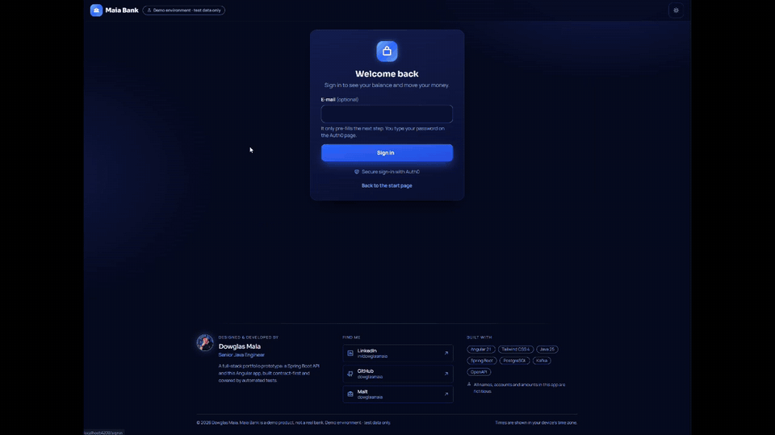

<div align="center">

# 🏦 Maia Bank — Financial Transaction Service

**A full-stack digital-bank prototype: Pix, deposits, mobile top-ups and ATM withdrawals — built spec by spec with Claude Code.**

A Spring Boot API and an Angular web app, designed contract-first, covered by hundreds of automated tests, and delivered through Specification-Driven Development (SDD).

[](https://github.com/dowglasmaia/financial-transaction-service-api-sboot/actions/workflows/api-ci.yml)
[](https://github.com/dowglasmaia/financial-transaction-service-api-sboot/actions/workflows/app-ci.yml)
[](https://github.com/dowglasmaia/financial-transaction-service-api-sboot/actions/workflows/codeql.yml)


</div>

<p align="center">
  
  <br /><sub>30-second tour of the app (sped up). Sign in, statement, Pix, deposit, recharge and withdrawal.</sub>
</p>

> **Demo product.** Maia Bank is a portfolio prototype, not a real bank. Every name, account and amount is fictitious, and no real money moves.

---

## 📑 Table of contents

1. [What is this project?](#-what-is-this-project)
2. [The product and its business rules](#-the-product-and-its-business-rules)
3. [Architecture](#-architecture)
4. [Technology stack](#-technology-stack)
5. [How it is built: SDD + Claude Code](#-how-it-is-built-sdd--claude-code)
6. [Quality and proof](#-quality-and-proof)
7. [Repository layout](#-repository-layout)
8. [Run back and front together](#run-back-and-front-together)
9. [Authentication (Auth0)](#authentication-auth0---how-it-works-and-how-to-configure-it)
10. [Project status](#-project-status)
11. [About the developer](#-about-the-developer)

---

## 🎯 What is this project?

Maia Bank is the kind of product a modern neobank ships: a customer signs in, sees the balance and the latest activity, and can **send a Pix**, **deposit** money, **top up a mobile phone** or **withdraw cash** — with a clear statement of everything that happened.

It exists for two reasons:

| | |
|---|---|
| **Business** | Show how a small money-moving product can be correct, safe and pleasant to use: no customer is ever left debited by a failed payment, no operation runs twice by accident, and nobody can see another customer's data. |
| **Engineering** | Show a professional way of working with AI: a human owner who decides, written specifications that define "done", and an AI agent (Claude Code) that implements them test-first, one small step at a time, under review. |

It is a **monorepo** with two applications that move together:

| Part | What it is | Folder |
|---|---|---|
| ☕ **Backend** | Spring Boot REST API — the single source of truth for money | [`api-financial-transaction-service`](api-financial-transaction-service) |
| 🅰️ **Frontend** | Angular web app — dark and light themes, responsive, tested at 1280, 768 and 390 px | [`app-financial-transaction-service`](app-financial-transaction-service) |
| 📐 **Specs** | The SDD knowledge base: product memory, technical memory, 20+ specs | [`.spec`](.spec) |

---

## 💼 The product and its business rules

### What a customer can do

| Capability | What happens | Endpoint (`/api/v1`) |
|---|---|---|
| **Sign in** | Auth0 Universal Login (the app never sees a password) | — |
| **See the account** | Agency, number and balance of the signed-in customer | `GET /accounts/me` |
| **Read the statement** | Filter by period, type and page; totals of money in and out; open any transaction | `GET /transactions`, `GET /transactions/{id}` |
| **Send a Pix** | Three steps: key → amount → review. Keys: CPF, e-mail or phone | `POST /transactions/send-pix` |
| **Deposit** | Credit any existing account (a boleto is simulated over the real deposit) | `POST /transactions/deposit` |
| **Top up a mobile phone** | Carriers VIVO, CLARO, TIM and ALGAR; shown as *requested*, never "completed" | `POST /transactions/recharge-mobile` |
| **Withdraw at an ATM** | Debits the caller's account; quick-amount presets | `POST /transactions/atm-withdrawal` |

### Rules the system never breaks

These rules are the business heart of the project. Each one is written in the specs and protected by tests.

- 🛡️ **A failed Pix never leaves the customer debited.** The flow is *reserve* (debit + pending ledger row) → call the external bank (MaiaBank) → *confirm* or *compensate* (credit back). A circuit breaker and timeouts protect the call.
- ⚖️ **The balance rule lives in one place.** A debit is allowed only when `balance ≥ amount`, and it is atomic, so two simultaneous requests can never overdraw an account.
- 🔁 **No operation runs twice by accident.** Every money request accepts an `Idempotency-Key`. The same key returns the stored answer (`Idempotent-Replayed: true`) instead of moving money again.
- 🔒 **You only see your own data.** The token's `sub` is linked to one customer; a foreign resource answers `404`, and a valid token without the `customer` role answers `403`.
- 💶 **Money is exact.** `BigDecimal`, at most two decimal places. More places are rejected with `422`, never silently rounded.
- 📨 **No lost events.** A recharge writes the debit, the ledger row and the Kafka event in **one** transaction (transactional outbox, at-least-once).
- 🙈 **Privacy by default.** Logs never carry an account number, agency, Pix key, phone, e-mail or token; Pix keys are masked on screen.
- ⏱️ **Honest about uncertainty.** After a network error on a write, the app never retries by itself: it tells the customer to check the statement.

> Full behaviour contract: [`.spec/memory/produto.md`](.spec/memory/produto.md).

---

## 🧱 Architecture

```
                         ┌──────────────────────────┐
   Browser               │   Auth0 (OIDC + PKCE)    │
 ┌──────────────┐ login  │   roles claim in the     │
 │ Angular 21   │◄──────►│   access token (JWT)     │
 │ signals,     │        └────────────┬─────────────┘
 │ Tailwind 4   │                     │ JWKS (public keys)
 └──────┬───────┘                     ▼
        │ HTTPS + Bearer token ┌───────────────────────────────────────────┐
        └─────────────────────►│ Spring Boot API (resource server)         │
                               │  api ─► application ─► domain             │
                               │  (REST)  (use cases)   (pure Java)        │
                               │           ▲                               │
                               │           └── infrastructure (adapters)   │
                               └───┬───────────┬────────────┬──────────────┘
                                   │           │            │
                             ┌─────▼────┐ ┌────▼─────┐ ┌────▼──────────┐
                             │PostgreSQL│ │  Kafka   │ │ MaiaBank API  │
                             │ + Flyway │ │ (outbox) │ │ (Pix, Feign + │
                             └──────────┘ └──────────┘ │ Resilience4j) │
                                                       └───────────────┘
```

### Backend: "Hexagonal Pragmática"

The API is organised **by feature**, with dependencies pointing inward and a domain that knows no framework:

```
com.dowglasmaia.financialtransaction
├── account/        api · application (port, usecase) · domain · infrastructure
├── transaction/    api · application (port, usecase) · domain · infrastructure
└── shared/         error · idempotency · money · security · web   (kept minimal)
```

- **One use case class per operation** (`MakePixTransferUseCase`, `MakeDepositUseCase`, …).
- **Ports only for outputs** (repositories, MaiaBank client, event publisher, caller identity).
- **Enforced, not hoped for:** an ArchUnit test runs in every build, and an offline checker reports `0 violation(s)` in strict mode.
- **Contract-first:** the OpenAPI file is the contract; interfaces and models are generated from it, and the CI compares versions with `openapi-diff`.

### Frontend

Angular 21 with standalone components, signals, a shared `OperationController` (one request in flight, no automatic retry of writes) and a design system shared by every page: stepper, amount presets, review dialog and result panel. The UI follows an approved visual prototype ([`prototype/`](prototype)).

---

## ⚡ Technology stack

### ☕ Backend

-007396?style=flat-square&logo=openjdk&logoColor=white)
[](https://spring.io/projects/spring-boot)
[](https://spring.io/projects/spring-security)
[](https://spring.io/projects/spring-data-jpa)
[](https://spring.io/projects/spring-cloud-openfeign)
[](https://resilience4j.github.io/resilience4j/)
[](https://maven.apache.org/)
[](https://www.openapis.org/)
[](https://projectlombok.org/)

### 🗄️ Data, messaging and security

[](https://www.postgresql.org/)
[](https://flywaydb.org/)
[](https://kafka.apache.org/)
[-EB5424?style=flat-square&logo=auth0&logoColor=white)](https://auth0.com/)
[](https://jwt.io/)

### 🅰️ Frontend

[](https://angular.dev/)
[](https://www.typescriptlang.org/)
[](https://rxjs.dev/)
[](https://tailwindcss.com/)
[](https://github.com/auth0/auth0-angular)
[](https://nginx.org/)

### 🧪 Quality and security

[](https://junit.org/junit5/)
[](https://testcontainers.com/)
[](https://vitest.dev/)
[](https://playwright.dev/)
[](https://www.deque.com/axe/)
[](https://www.archunit.org/)
[](https://www.jacoco.org/)
[](https://codeql.github.com/)
[](https://docs.github.com/en/code-security/dependabot)

### 📈 Observability and delivery

[](https://micrometer.io/)
[](https://prometheus.io/)
[](https://www.docker.com/)
[](https://github.com/features/actions)
[](https://www.postman.com/)

### 🤖 AI-driven workflow

[](https://claude.com/claude-code)


---

## 🤖 How it is built: SDD + Claude Code

This project is as much about **how** it was built as about **what** was built.

### The idea

> **Nothing is implemented without an approved spec. Nothing is "done" without evidence.**

The owner (a human) decides *what* and *why*. Claude Code does the typing, always inside a written specification, always test-first, and always stopping where a decision belongs to the owner.

```
   ┌─────────────┐   approve   ┌─────────────┐  tests first  ┌──────────────┐
   │ 1. SPEC     │────────────►│ 2. BRANCH   │──────────────►│ 3. IMPLEMENT │
   │ goal, scope │             │ from a      │  (see red,    │ smallest step│
   │ tasks, gates│             │ fresh main  │   then green) │ one commit   │
   └──────▲──────┘             └─────────────┘               └──────┬───────┘
          │                                                         │
   ┌──────┴───────┐   owner opens the PR,   ┌─────────────┐   ┌─────▼────────┐
   │ 6. MEMORY    │◄── CI green, merges ────│ 5. REVIEW   │◄──│ 4. EVIDENCE  │
   │ kept in sync │                         │ human gate  │   │ tick a task  │
   └──────────────┘                         └─────────────┘   │ only w/ proof│
                                                              └──────────────┘
```

### The four building blocks

| Block | What it is | Where |
|---|---|---|
| 📐 **Specs** | One file per piece of work: goal, scope, tasks, acceptance criteria, a *Minimal validation* block and "Stop and ask" gates | [`.spec/specs`](.spec/specs) |
| 🧠 **Memory** | What the agent must read first: the product contract and the technical decisions (numbered `D-xx`) | [`.spec/memory`](.spec/memory) |
| 🧰 **Skills** | Reusable expertise packages that Claude Code loads on demand (see below) | `~/.claude/skills` |
| 🔍 **Reviews and gates** | Human approval points, CI pipelines and an architecture checker | [`.spec/spec-execution-flow.md`](.spec/spec-execution-flow.md) |

### Skills used

Skills give the agent consistent, project-grade habits instead of improvising each time.

| Skill | Used for |
|---|---|
| `java-spring-create-module` | Creating and migrating backend features into the hexagonal layout, with a scaffold script and an architecture checker |
| `openapi-rest-contract` | Contract-first changes: **preview → explicit approval → generate** |
| `java-modern-engineering` | Idiomatic Java 17/21/25 code, refactoring and migrations |
| `java-persistence-performance` | JPA, SQL, transactions, concurrency and Flyway |
| `springboot-patterns` | REST, layering, logging and async patterns |
| `angular-architect` · `angular-developer` | Angular 21 structure, signals, forms, HTTP and tests |
| `angular-module-scaffold` | Feature pages built from approved OpenAPI operations |
| `angular-tailwind-ui-specialist` · `ui-ux-pro-max` | Responsive, accessible UI with design tokens |

### The workflow in practice

1. **Foundation specs** (`MONO`, `BE-01…04`, `FE-02`): monorepo, a safety net of characterization tests, Flyway, money integrity, Auth0 and ownership.
2. **Architecture specs** (`ARCH-01/02`): the backend moved to the hexagonal layout with **behaviour frozen** and guarded by the existing tests.
3. **Vertical slices** (`SL-00…SL-06`): one slice = one branch = one PR carrying **backend + frontend + e2e** for one user-visible capability: sign-in, statement, withdrawal, deposit and recharge, Pix.
4. **Closing specs** (`BE-07`, `BE-08`): Spring Boot 3.5 and Java 25, then clean-up and hardening (exact money, correlation id, private management port, PII-free logs, GitHub-native scans).
5. **Final rounds** (`E2E-01`, `FINAL-01`): a Cypress suite and a manual test round by the owner.

### Rules the agent follows every time

- ✅ **Tests first:** write the failing test, watch it fail, then make it pass.
- ✅ **One commit per task**, named `<SPEC>: <task>`.
- ✅ **Tick a task only with an evidence line** (command, result, count).
- ✅ **Report honestly** what was executed and what was only written.
- ⛔ **Stop and ask** when a contract, behaviour or scope change is not in the spec.
- ⛔ **Never** open the PR, merge, or push to `main`: those are the owner's steps.
- ⛔ **Never** type a password or handle a secret: the real Auth0 login is a manual step, and automated tests use a mock identity provider.

### Human decisions that shaped the project

Some choices were deliberately left to the owner, for example: reject amounts with more than two decimals instead of rounding (`422`); use only GitHub-native security scans; use Eclipse Temurin images; keep access tokens in memory only; keep Playwright and add one Cypress spec on top. Every decision is recorded in [`.spec/memory/contexto-tecnico.md`](.spec/memory/contexto-tecnico.md).

---

## ✅ Quality and proof

| Check | Result | Where it runs |
|---|---|---|
| Backend tests (unit + integration with a real PostgreSQL) | **410 tests, 0 failures** on Java 25 | `api-ci` / `./mvnw verify` |
| Architecture rules (ArchUnit + strict checker) | **0 violations** | every build |
| Browser tests (Playwright, mock identity provider) | **114 / 114** across 3 viewports (1280, 768, 390 px) | `npm run e2e` |
| Accessibility (axe) | Run inside the e2e flows | `npm run e2e` |
| Deprecated Java APIs (`jdeprscan --release 25`) | **0** | BE-07 |
| Static security analysis | CodeQL (Java, TypeScript); first runs happen on GitHub | GitHub Actions |
| Dependency updates | Dependabot (Maven, npm, Docker, Actions); configured, runs on GitHub | GitHub |
| API compatibility | `openapi-diff` between contract versions | `api-ci` |

The numbers above were measured during the specs; see each spec's *Result* section for the evidence line. Checks that exist but have not run yet are marked as such in the specs.

---

## 📂 Repository layout

| Folder | What | CI |
|---|---|---|
| `api-financial-transaction-service/` | Spring Boot API (Pix, deposit, recharge, withdrawal, statement) | `.github/workflows/api-ci.yml` |
| `app-financial-transaction-service/` | Angular web app | `.github/workflows/app-ci.yml` |
| `prototype/` | Approved UI/UX prototype - visual and flow reference for the frontend | - |
| `.spec/` | SDD knowledge base: `memory/`, `specs/`, execution flow | - |
| `docker-compose.yml` | The whole stack in one file (web, API, PostgreSQL, Kafka, MaiaBank stub; mock IdP with `--profile e2e`) | - |
| `e2e.env` | Overrides that point the stack at the mock identity provider (no secret) | - |

Each application has its own isolated, path-filtered pipeline and is built and tested independently. More detail: [API README](api-financial-transaction-service/README.md) · [App README](app-financial-transaction-service/README.md).

---

## Run back and front together

**One compose file runs everything.** `docker-compose.yml` holds the web app, the API and every dependency, so a single command brings the whole product up. Ports: web app `4200`, API `8088`, PostgreSQL `5433`, Kafka `9092`, Kafdrop `19000`, MaiaBank stub `8089`.

| Service | What | Port |
|---|---|---|
| `financial-transaction-web` | Angular build served by nginx, forwards `/api/` to the API | `4200` |
| `financial-transaction-api` | Spring Boot API (profile `local`: demo seed) | `8088` |
| `pg-db` | PostgreSQL 14 (healthcheck) | `5433` |
| `zookeeper` · `kafka` · `kafdrop` | Kafka broker and its web UI | `9092` · `19000` |
| `maiabank-api` | Stub of the external bank used by Pix | `8089` |
| `mock-idp` | Mock identity provider, **only** with `--profile e2e` | `9099` |

```bash
cp .env.example .env                  # once (local, throw-away values); add SEED_OWNER_SUB / SEED_SECOND_SUB
docker compose up -d --build          # the whole stack: open http://localhost:4200
docker compose down                   # stop it (data stays in the postgresql_data volume)
```

The API waits for PostgreSQL to be healthy, and the web app waits for the API to be healthy (`/actuator/health` on the private port `8090`, never published).

**Only the dependencies** (when you run the API from the IDE and the app with `npm start`):

```bash
docker compose up -d pg-db zookeeper kafka kafdrop maiabank-api
```

**API from the IDE** - run configuration with `SPRING_PROFILES_ACTIVE=local`, `SEED_OWNER_SUB`, optional `SEED_SECOND_SUB`. In Docker the two `SEED_*` values come from `.env` (the Auth0 `user_id` of your test users).

**App from the terminal** - `cd app-financial-transaction-service && npm ci && npm start`, then open <http://localhost:4200> (stop the `financial-transaction-web` container first, or set `WEB_PORT`). The dev server proxies `/api` to `localhost:8088`.

**Real Auth0 sign-in (manual):** in the Auth0 dashboard (application *Transaction-app*) add `http://localhost:4200` to *Allowed Callback URLs*, *Allowed Logout URLs* and *Allowed Web Origins*. Then click **Access my account** and sign in with a test user. The app reads its Auth0 values from `app-financial-transaction-service/public/config.json` (public values only); the web container mounts that same file, so you can edit it without rebuilding.

**Automated end-to-end (no password, mock identity provider):** the same file, with the identity values overridden by `e2e.env` (it holds no secret) and the `e2e` profile that adds `mock-idp`:

```bash
docker compose --env-file .env --env-file e2e.env --profile e2e up -d --build
cd app-financial-transaction-service && npm run e2e:install && npm run e2e   # 3 viewports: 1280 / 768 / 390
docker compose --env-file .env --env-file e2e.env --profile e2e down         # back to the real Auth0 setup afterwards
```

Details of the e2e setup (mock IdP users, how the browser reaches it): `app-financial-transaction-service/e2e/README.md`. API details: `api-financial-transaction-service/README.md`. Work is driven by `.spec/spec-execution-flow.md`.

## Authentication (Auth0) - how it works and how to configure it

The API is an OAuth2 **resource server**: it never sees a password. A user signs in at Auth0, gets an **access token** (a signed JWT), and sends it as `Authorization: Bearer <token>`. The API checks the token by itself and then serves only that user's data.

```
User --(1) login page--> Auth0 (e-mail + password are typed at Auth0)
User <-(2) authorization code-- Auth0
App/Postman --(3) code + PKCE verifier--> Auth0 --> access token
App/Postman --(4) GET /api/v1/transactions + Bearer token--> API
API --(5) validates signature, issuer, audience, expiry, role claim
API --(6) token "sub" -> usuario.external_subject -> the customer's account
```

| Term | Meaning here |
|---|---|
| `sub` | The user id inside the token (`auth0\|65f...`). Linked to a customer in `usuario.external_subject`. Not linked = 403. |
| audience | `https://api.financial-transaction.local` - the API identifier; tokens for any other audience are rejected (401). |
| roles claim | `https://financial-transaction/roles` (array), added by a Post-Login Action. Needs `customer` or the API answers 403. |
| SPA client | `Transaction-app`, type *Single Page Application*: Authorization Code + PKCE, **no client secret**. |

Do not use the client-credentials flow (`client_id` + `client_secret`) for this: it issues a machine token with no user and no roles, which the API answers with 403. Never commit, paste or share a client secret; rotate it if it leaked.

### 1. Configure the Auth0 tenant (once)
Dashboard: <https://manage.auth0.com/>. Tenant used by this project: `dev-twljocmfwpvlxx1q.eu.auth0.com`.

1. **Application** (*Applications > Applications > Transaction-app > Settings*)
   - *Application Type* = **Single Page Application**.
   - *Allowed Callback URLs*, *Allowed Logout URLs*, *Allowed Web Origins* = `http://localhost:4200` (add `https://oauth.pstmn.io/v1/callback` to the callback list if you test with Postman). Leave *Cross-Origin Authentication* off and the *Allowed Origins (CORS)* box empty.
   - *Refresh Token Rotation* = on. Click **Save Changes** (nothing is autosaved).
2. **Authorize the app on the API** (*Applications > APIs*) — **without this every sign-in is refused** with `Client "…" is not authorized to access resource server "https://api.financial-transaction.local"`
   1. Open the API whose *Identifier* is `https://api.financial-transaction.local` (name `Financial Transaction API`; create it if it does not exist: signing algorithm **RS256**, *Allow Offline Access* on, a short *Token Expiration* such as 3600 s; never reuse the built-in "Auth0 Management API").
   2. Open the **Application Access** tab (in some dashboards it is called *Machine to Machine Applications*).
   3. Find **Transaction-app** and authorize it. Under *User Access* leave **Authorized** (client access: none; no permissions/scopes are needed).
   4. Save.
   5. Check on the application itself (*Applications > Applications > Transaction-app > Settings*) that `http://localhost:4200` is in **Allowed Callback URLs**, **Allowed Logout URLs** and **Allowed Web Origins**, then **Save Changes**.
3. **Post-Login Action** (*Actions > Library > Create Action > Build from scratch*, trigger *Login / Post Login*) - paste and **Deploy**:
   ```js
   exports.onExecutePostLogin = async (event, api) => {
     const namespace = 'https://financial-transaction/roles';
     // the roles assigned in Auth0 (step 5); a user with no role at all falls back to customer
     const roles = event.authorization?.roles?.length ? event.authorization.roles : ['customer'];
     api.accessToken.setCustomClaim(namespace, roles);   // accessToken, NOT idToken: the API reads the access token
   };
   ```
   Then *Actions > Triggers > post-login*: drag the Action **into the flow** (between Start and Complete) and click **Apply**. A deployed but unattached Action issues no claim, and the API answers 403 to every call.
4. **Users** (*User Management > Users > Create User*, connection `Username-Password-Authentication`): create at least two test users (the second one proves a customer cannot touch the first one's data). Copy each **user_id** (`auth0|...`). Then *Authentication > Database > Username-Password-Authentication > Settings*: turn **Disable Sign Ups** on.
5. **Roles** (*User Management > Roles > Create Role*): create `customer` and `admin` (exact names, lower case; the API upper-cases them to `ROLE_CUSTOMER` / `ROLE_ADMIN`). Do **not** add permissions: the system does not use scopes. Then *User Management > Users > (user) > Roles > Assign Roles* and give each test user the roles it needs:

   | Role | What it opens |
   |---|---|
   | `customer` | The whole business API (`/api/**`), and only if the user's `sub` is linked to an account |
   | `admin` | The actuator endpoints other than health and Prometheus (port 8090, never published) |

   **Always assign `customer` together with `admin`.** The Action sends the roles assigned in Auth0, and only falls back to `customer` when the user has none: a user with `admin` alone loses `customer` and gets 403 on every business call. Roles reach the token only at sign-in, so **sign out and sign in again** after changing them.

### 2. Run the API linked to a test user
The local seed creates one demo customer (account `2022`). Link it to the first test user's `user_id`:

```bash
export SPRING_PROFILES_ACTIVE=local
export SEED_OWNER_SUB='auth0|<user_id of the first test user>'
```

Other settings have defaults for this tenant and can be overridden: `AUTH_ISSUER` (with the **trailing slash**), `AUTH_AUDIENCE`, `AUTH_ROLES_CLAIM`, `CORS_ALLOWED_ORIGINS` (see `.env.example`). With `docker compose`, put `SEED_OWNER_SUB` in `.env`.

### Sign-in problems and what they mean
| What you see | Cause | Fix |
|---|---|---|
| Clicking **Sign in** returns to the sign-in page with *"Auth0 said: Client … is not authorized to access resource server …"* | *Transaction-app* is not authorized on the API | Section 1, item 2 above (Application Access > Authorized) |
| *"Callback URL mismatch"* or a CORS/origin error on the Auth0 page | `http://localhost:4200` missing from the application URLs | Section 1, items 1 and 2.5 above |
| After signing in, Home shows **"no access"** and the browser console shows `GET /api/v1/accounts/me 403` | The token is valid but refused. **The API console says which reason** (INFO line): `Access denied (403): the token has no ROLE_CUSTOMER (roles in the token: [...])` = the user has another Auth0 role assigned (the Action then sends that role instead of `customer`): remove it under *User Management > Users > (user) > Roles*, or fix the Action; `Access denied (403): the token subject is not linked to a customer` = the user's `sub` is not `SEED_OWNER_SUB`/`SEED_SECOND_SUB` | Fix as described, then restart the API (the seed relinks on start) and sign in again |
| Same 403, and the decoded token has **no** `https://financial-transaction/roles` claim (found 2026-11-04) | Roles are assigned to the user but the **Action** is not in the Login flow, is not deployed, writes to the ID token, or names the claim without `https://`. Assigning roles alone never adds the claim | Section 1, item 3 (Deploy, drag into *post-login*, **Apply**), then sign out and in. Check with "Inspect your token" below |
| The sign-in goes straight to Home without a form | An old Auth0 single-sign-on session exists | Not a bug; since 2026-11-04 the app asks for the form every time (`prompt=login`). **Sign out** also ends the Auth0 session |
| After a page reload you must click Sign in again | Tokens are kept in memory only (owner decision) | Expected; one click, no password (the Auth0 cookie signs you in again) |

### Inspect your token (roles check)
Copy the access token from the browser (*Network* tab > any `/api/v1/...` request > `Authorization` header, without the word `Bearer`) into an environment variable and print its claims (the signature is not needed, and the token is not sent anywhere):

```bash
TOKEN='<paste the access token>' node -e "const p=JSON.parse(Buffer.from(process.env.TOKEN.split('.')[1],'base64url'));console.log({sub:p.sub,aud:p.aud,exp:new Date(p.exp*1000).toISOString(),roles:p['https://financial-transaction/roles']})"
```

Expected: `aud` contains `https://api.financial-transaction.local` and `roles` is `[ 'customer', 'admin' ]` (or `[ 'customer' ]`). `roles: undefined` means the Action did not run for this sign-in. Treat a token as a password until it expires (about 24 h): do not paste it into chats, issues or commits.

### 3. Get a user token (Postman)
*Authorization* tab > type **OAuth 2.0** > Grant Type **Authorization Code (With PKCE)**:

| Field | Value |
|---|---|
| Auth URL | `https://dev-twljocmfwpvlxx1q.eu.auth0.com/authorize?audience=https://api.financial-transaction.local` |
| Access Token URL | `https://dev-twljocmfwpvlxx1q.eu.auth0.com/oauth/token` |
| Client ID | the `Transaction-app` Client ID |
| Client Secret | **empty** |
| Callback URL | `https://oauth.pstmn.io/v1/callback` |
| Scope | `openid profile email offline_access` |

Click **Get New Access Token**, sign in as the test user in the Auth0 window, and use the token. The `audience` parameter is mandatory: without it Auth0 returns an opaque token that the API cannot validate.

### 4. Check it works
`GET http://localhost:8080/api/v1/transactions?initial-date=01/01/2000&final-date=31/12/2100` with the Bearer token:

| Status | Meaning | Usual cause |
|---|---|---|
| 200 | Signed in and linked | - |
| 401 | Token rejected | wrong issuer (missing trailing slash), wrong/missing audience, expired token, opaque token |
| 403 | Token valid but not allowed | Action not deployed/attached (no roles claim), or `SEED_OWNER_SUB` differs from the token `sub` |
| 404 on another customer's data | Ownership working | - |

More symptoms and fixes: `.claude/skills/auth-oidc-config/references/auth0-portal-guide.md` (project skill `auth-oidc-config`, which also validates the inputs, generates the configuration files and verifies the tenant and a token). Design and decisions: `.spec/auth-auth0.md`.

---

## 📊 Project status

| Area | Status |
|---|---|
| Backend: money integrity, Auth0 resource server, ownership, idempotency | ✅ Done |
| Backend: hexagonal architecture, Java 25 / Spring Boot 3.5, hardening | ✅ Implemented (BE-07, BE-08) |
| Frontend: sign-in, Home, statement, withdrawal, deposit, recharge, Pix | ✅ Done (slices SL-00…SL-06) |
| Cypress suite (`E2E-01`) | 📝 Specified, waiting for the owner's approval |
| Final manual test round (`FINAL-01`) | 🔜 Next |

The index with every spec and its status is in [`.spec/specs/README.md`](.spec/specs/README.md). Not planned on purpose: account registration, cards, budgets, scheduled payments, a mobile app and real KYC.

---

## 👨‍💻 About the developer

<table>
  <tr>
    <td align="center" width="160">
      
    </td>
    <td>
      <h3>Dowglas Maia</h3>
      <p><strong>Senior Java Engineer</strong> — designed and developed this project.</p>
      <p>
        I build back-end systems with Java and Spring Boot, modern front ends with Angular, and I like to
        make the whole path visible: from the business rule, to the specification, to the test that proves it.
        This repository is my way of showing how I work with AI as a teammate: the decisions stay human, and the
        agent works inside a spec, under tests and review.
      </p>
      <p>
        <a href="https://www.linkedin.com/in/dowglasmaia/"></a>
        <a href="https://github.com/dowglasmaia"></a>
        <a href="https://www.malt.com/profile/dowglasmaia"></a>
      </p>
    </td>
  </tr>
</table>

**What this project shows about my work**

- Business rules turned into code that cannot be bypassed (atomic balance, compensation, idempotency, ownership).
- Hexagonal architecture that is *checked by tests*, not only drawn in a diagram.
- Full-stack delivery in vertical slices, with the contract, the API, the UI and the browser tests moving together.
- Security and privacy as part of the design: OIDC with PKCE, role-based access, private management port, PII-free logs.
- A repeatable way of working with an AI agent: specs, memory, skills, evidence and human review.

---

<div align="center">

© Dowglas Maia · Maia Bank is a demo product, not a real bank · Test data only

</div>
